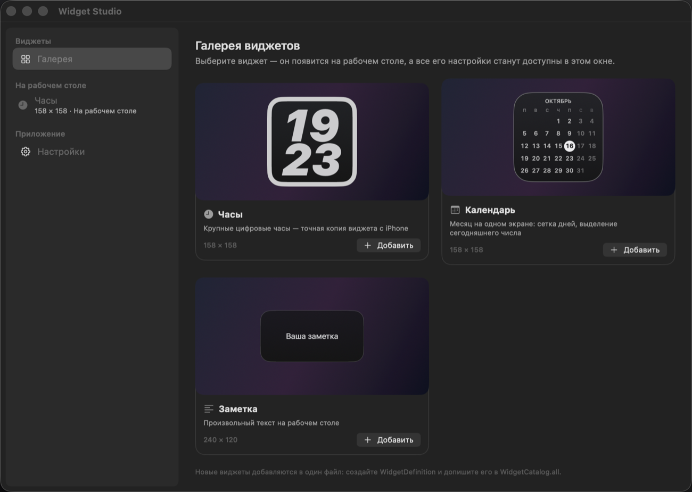

# Widget Studio

**Кастомизируемые виджеты для рабочего стола macOS.** Первый виджет — точная копия
часов с iPhone, которые macOS «отзеркаливает» на рабочий стол: чёрная карточка,
светлая рамка 8 pt, огромные наклонные цифры.


*Слева — оригинальный виджет, перенесённый с iPhone. Справа — виджет, нарисованный
Widget Studio с настройками по умолчанию.*

В репозитории сразу три виджета (часы, календарь, заметка) и полноценный движок
кастомизации: любой виджет можно перенастроить до последнего пикселя, а новый
виджет добавляется одним файлом.

## Возможности

**Виджеты**
- 🕘 **Часы** — две строки или одна, 12/24 часа, ведущий ноль, секунды, дата,
  мигающее двоеточие, любой часовой пояс (Москва, Нью-Йорк, Токио…).
- 📅 **Календарь** — сетка месяца, неделя с понедельника или с воскресенья,
  выделение сегодняшнего дня, дни соседних месяцев, год в заголовке.
- 📝 **Заметка** — любой текст на рабочем столе.

**Оформление каждого виджета (общий движок)**
- фон: сплошной / градиент с настраиваемым углом / «стекло» / без фона;
- два цвета фона, цвет и толщина рамки, скругление углов, внутренние отступы,
  прозрачность, системная тень;
- типографика: гарнитура (системная, округлая, моноширинная, с засечками),
  насыщенность, размер, курсив, дополнительный наклон, межбуквенный и
  межстрочный интервал, цвет текста, яркость дополнительного текста;
- готовые стили в один клик: «Как на iPhone», «Минимализм», «Стекло», «Неон»,
  «Гигантские», «Классика»;
- размер и позиция: пресеты 158×158 / 338×158 / 338×338, свободные ширина и
  высота, точные координаты.

**Поведение**
- три уровня окна: **на рабочем столе** (под обычными окнами, как системные
  виджеты), обычное окно, поверх всех окон;
- перетаскивание мышью с прилипанием к сетке и краям экрана;
- блокировка перемещения, режим «не реагировать на клики», скрытие;
- кнопки «настроить» и «скрыть» при наведении, контекстное меню по правой кнопке;
- двуязычный интерфейс (русский / English), значок в Dock по желанию;
- всё состояние хранится в JSON, есть экспорт/импорт конфигурации.

## Скриншоты

| Галерея виджетов | Кастомизация |
| --- | --- |
|  |  |

## Требования

- macOS 13 или новее;
- Xcode Command Line Tools (`xcode-select --install`) — этого достаточно,
  полноценный Xcode не нужен.

## Сборка и запуск

```bash
git clone https://github.com/AlexPogyl/widget-studio.git
cd widget-studio
./run.sh          # собрать и запустить
```

Или по шагам:

```bash
./build.sh                       # собирает dist/Widget Studio.app
open "dist/Widget Studio.app"
```

Приложение живёт в строке меню (значок из четырёх квадратов) и сразу создаёт
часы в левом верхнем углу рабочего стола.

## Как пользоваться

- **Перетаскивание** — потяните виджет мышью; при отпускании он прилипает к сетке
  и к краям экрана.
- **Правая кнопка** — контекстное меню: настроить, дублировать, уровень окна,
  заблокировать, скрыть, сбросить оформление, удалить.
- **Наведение** — в углу карточки появляются кнопки «настроить» и «скрыть».
- **Строка меню** — открыть окно настроек (⌘,), скрыть/показать все виджеты,
  быстро добавить виджет, выход.
- **Окно настроек** — слева галерея и список размещённых виджетов, справа живой
  предпросмотр и все параметры выбранного виджета.

Конфигурация: `~/Library/Application Support/WidgetStudio/config.json`.

## Как добавить новый виджет

Достаточно одного файла: опишите `WidgetDefinition` (имя, размер, список настроек,
готовые стили и функцию отрисовки) и допишите его в `WidgetCatalog.all`.

```swift
enum BatteryWidget {
    static let group = LText("Батарея", "Battery")

    static let definition = WidgetDefinition(
        id: "battery",
        name: LText("Батарея", "Battery"),
        summary: LText("Заряд ноутбука", "Laptop battery level"),
        symbol: "battery.100",
        defaultSize: CGSize(width: 158, height: 158),
        settings: [
            .toggle("battery.showPercent", LText("Показывать проценты", "Show percentage"),
                    group: group, default: true),
            .slider("battery.warningLevel", LText("Порог предупреждения", "Warning level"),
                    group: group, range: 5...50, step: 5, default: 20, unit: "%")
        ],
        presets: [],
        content: { context in AnyView(BatteryContentView(context: context)) },
        overrides: ["common.fontSize": .number(36)]   // свои значения общих настроек
    )
}
```

Ничего больше делать не нужно: галерея, меню, сохранение, инспектор настроек и
готовые стили подхватят виджет автоматически — UI строится из схемы настроек
(`SettingDescriptor`), а не пишется руками.

## Структура проекта

```
Sources/WidgetStudio/
├── main.swift                  запуск NSApplication
├── App/                        состояние, локализация, статус-бар, главное меню
├── Model/                      настройки, схема кастомизации, конфигурация, каталог виджетов
├── Widgets/                    сами виджеты: ClockWidget, CalendarWidget, NoteWidget
├── Windows/                    окна виджетов и окно настроек
└── Views/                      рендер виджета, галерея, инспектор, контролы настроек
```

## Разработка

```bash
swift build -c release           # быстрая сборка без упаковки в .app
WIDGETSTUDIO_CONFIG=/tmp/test.json \
  "dist/Widget Studio.app/Contents/MacOS/WidgetStudio"   # отдельный профиль настроек
WIDGETSTUDIO_SHOW_SETTINGS=inspector ...                 # сразу открыть инспектор
```

## Лицензия

MIT — см. [LICENSE](LICENSE).

---

# Widget Studio (English)

**Customizable desktop widgets for macOS.** The first widget is a faithful copy of
the iPhone clock that macOS mirrors onto the desktop: a black card, an 8 pt light
ring and huge oblique digits.

Three widgets ship out of the box (clock, calendar, note) plus a full
customization engine: every widget can be tuned down to the last pixel, and a new
widget is a single file.

### Features

- **Clock** — one or two lines, 12/24 h, leading zero, seconds, date, blinking
  colon, any time zone.
- **Calendar** — month grid, Monday/Sunday first, today highlighted, adjacent
  month days, optional year.
- **Note** — any text on your desktop.
- Shared appearance engine: solid/gradient/glass/no background, two background
  colours, border colour and width, corner radius, padding, opacity, window
  shadow; typeface, weight, size, italic, extra slant, letter and line spacing,
  text colours.
- Ready-made presets: iPhone style, Minimal, Glass, Neon, Giant, Classic.
- Size presets 158×158 / 338×158 / 338×338 plus free width/height and exact
  coordinates.
- Window level: on the desktop (like the system widgets), normal, always on top.
- Drag with snapping to grid and screen edges, lock, click-through, hide,
  hover buttons, context menu, RU/EN interface, JSON config with import/export.

### Requirements

macOS 13+, Xcode Command Line Tools (`xcode-select --install`). Xcode itself is
not required.

### Build & run

```bash
git clone https://github.com/AlexPogyl/widget-studio.git
cd widget-studio
./run.sh
```

The app lives in the menu bar (four-squares icon) and creates a clock widget in
the top-left corner of the desktop on first launch.

The configuration file is stored at
`~/Library/Application Support/WidgetStudio/config.json`.

### Adding a widget

Create a file with a `WidgetDefinition` (name, size, settings schema, presets and
a render closure) and append it to `WidgetCatalog.all`. The gallery, menu bar,
persistence and the whole customization inspector are generated from the schema —
no UI code to write.

### License

MIT — see [LICENSE](LICENSE).
