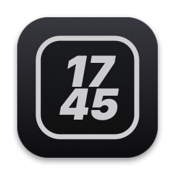
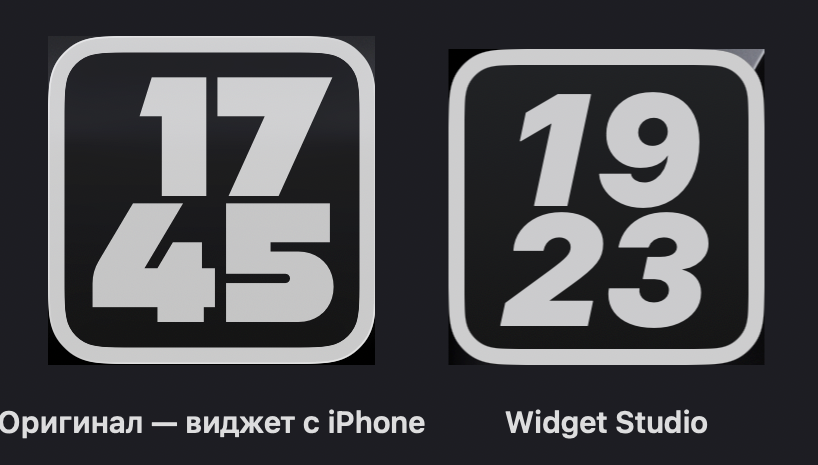
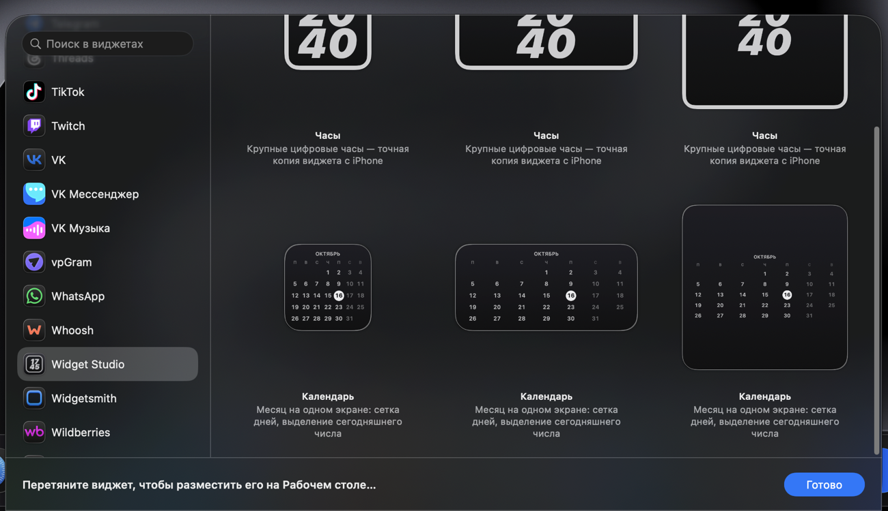
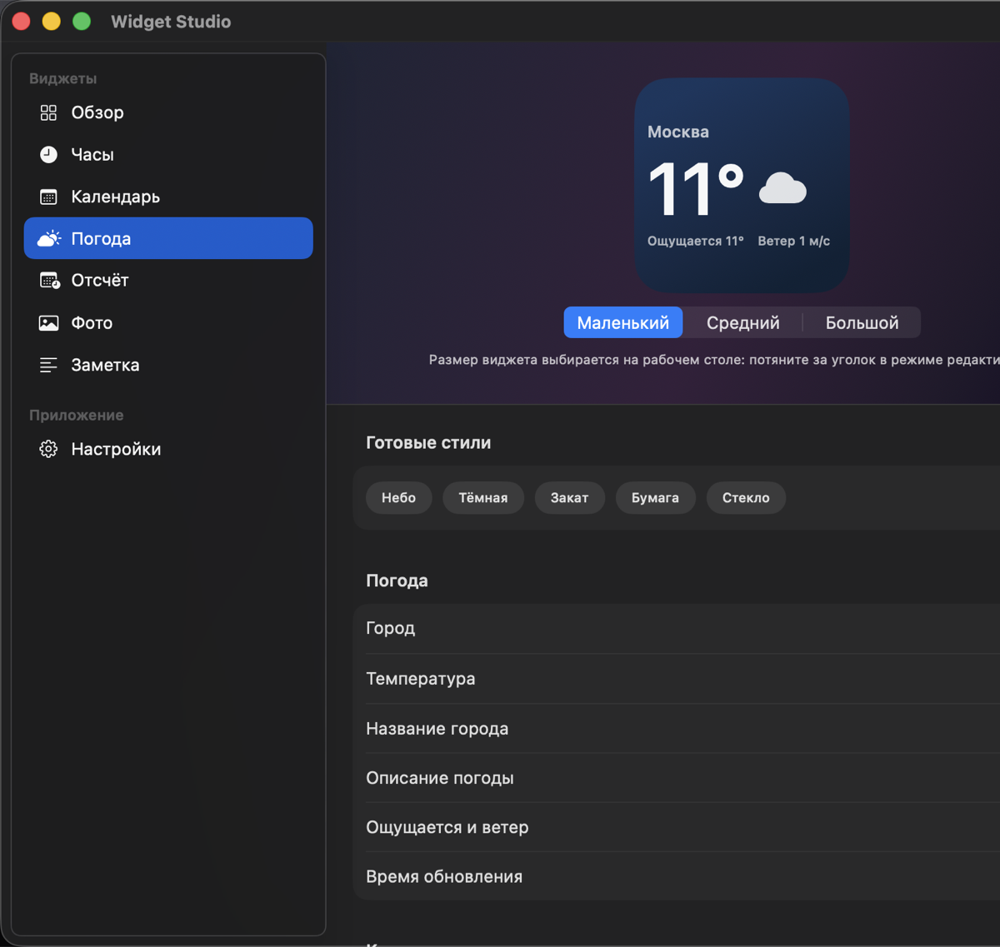
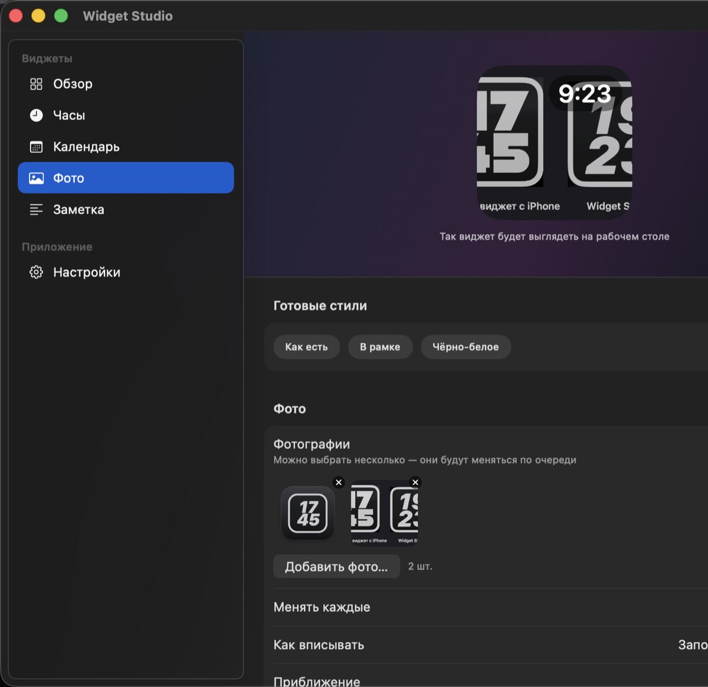
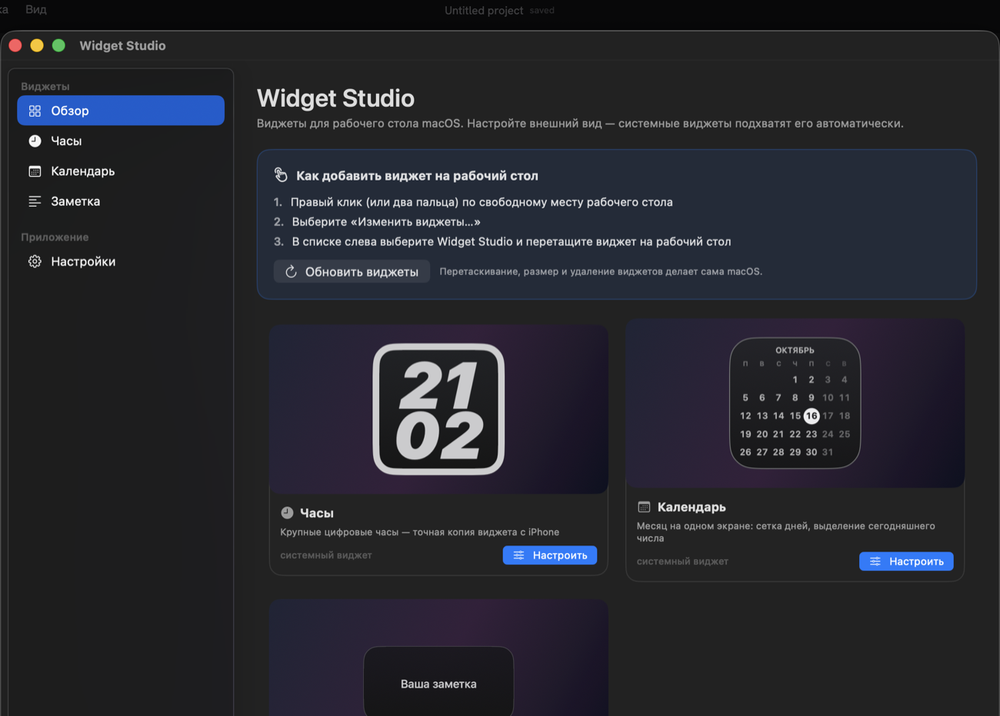
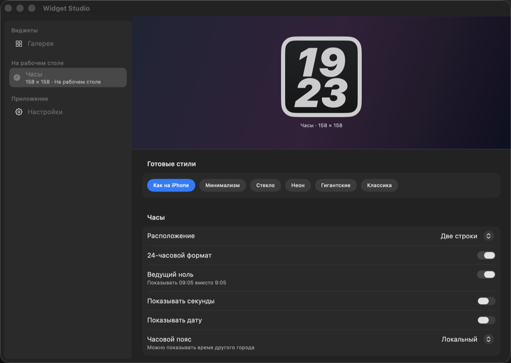

# Widget Studio

**Обычное приложение для macOS, которое настраивает системные виджеты рабочего стола.**
Виджеты добавляются штатной галереей macOS — правый клик (или два пальца) по
рабочему столу → **«Изменить виджеты…»** → *Widget Studio*. Дальше macOS сама
перетаскивает, двигает, меняет размер и удаляет их: никаких собственных окон и
самодельного перетаскивания.



Виджет часов — точная копия виджета с iPhone, который macOS «отзеркаливает» на
рабочий стол: чёрная карточка, светлая рамка 8 pt, огромные наклонные цифры.



*Слева — оригинальный виджет, перенесённый с iPhone. Справа — виджет, нарисованный
Widget Studio с настройками по умолчанию.*

## Как это работает



1. Настраиваете внешний вид виджета в приложении — справа живой предпросмотр
   ровно того, что увидите на рабочем столе.
2. Приложение кладёт настройки в `~/Library/Application Support/WidgetStudio/config.json`
   и просит систему перерисовать виджеты.
3. Расширение WidgetKit читает тот же файл и рисует системный виджет этим
   оформлением.



Изменения применяются на лету: правьте ползунки и смотрите на виджет на рабочем
столе (кнопка «Обновить виджеты» — если система не перерисовала сразу).

## Возможности

**Приложение**
- обычное приложение: значок в Dock, своя иконка, главное окно при запуске,
  полноценное меню (⌘, — настройки, ⌘Q — выход);
- значок в строке меню (можно отключить) с командой «Обновить виджеты»;
- обзор со всеми виджетами и инструкцией, как добавить их на рабочий стол;
- настройки на каждый вид виджета, экспорт и импорт конфигурации.

**Кастомизация**
- фон: сплошной / градиент с настраиваемым углом / «стекло» / без фона;
- два цвета фона, цвет и толщина рамки, скругление, внутренние отступы,
  прозрачность;
- типографика: гарнитура, насыщенность, размер, курсив, дополнительный наклон,
  межбуквенный и межстрочный интервал, цвета текста;
- инспектор показывает виджет во всех трёх системных размерах (маленький,
  средний, большой) — переключатель под предпросмотром;
- готовые стили в один клик, по 4–9 на каждый виджет: «Как на iPhone»,
  «Минимализм», «Стекло», «Неон», «Гигантские», «Классика», «Терминал»,
  «Янтарь», «Полночь», «Бумага», «Закат», «Полароид», «Цитата» и другие;
- **клик по виджету**: ничего не делать или открывать выбранное приложение
  (выбирается из списка, можно не выбирать).

**Виджеты**
- 🕘 **Часы** — две строки или одна, 12/24 часа, ведущий ноль, секунды, дата,
  мигающее двоеточие, любой часовой пояс.
- 📅 **Календарь** — сетка месяца, неделя с понедельника или воскресенья,
  выделение сегодняшнего дня, дни соседних месяцев, год в заголовке.
- 🌤 **Погода** — текущая погода в выбранном городе (Open-Meteo, без ключей и
  аккаунтов): температура, описание, «ощущается», ветер; 20 городов, °C/°F.
- ⏳ **Отсчёт** — сколько дней осталось до важной даты, с подписью, режимом
  «дни, часы, минуты» и обратным счётом после наступления.
- 📷 **Фото** — ваши картинки: одно фото или несколько, которые меняются по
  очереди (от минуты до суток), с приближением, чёрно-белым режимом,
  затемнением и часами в углу.
- 📝 **Заметка** — любой текст.

Все виджеты доступны и как системные: маленький, средний и большой размеры.



Фотографии приложение копирует в общий контейнер, поэтому системный виджет
(он работает в песочнице) может их показывать.

## Скриншоты

| Обзор | Кастомизация |
| --- | --- |
|  |  |

## Требования

- macOS 14 или новее (системные виджеты);
- Xcode Command Line Tools (`xcode-select --install`) — полноценный Xcode не нужен.

## Сборка и запуск

```bash
git clone https://github.com/AlexPogyl/widget-studio.git
cd widget-studio
./run.sh                    # собрать + зарегистрировать в системе + запустить
```

По шагам:

```bash
./build.sh                  # dist/Widget Studio.app (вместе с WidgetKit-расширением)
./build.sh --register       # ещё и зарегистрировать в системе (lsregister + pluginkit)
open "dist/Widget Studio.app"
```

Чтобы виджет появился в галерее:

1. `./build.sh --register` (или просто перенесите `Widget Studio.app` в
   `/Applications` — LaunchServices подхватит его сам);
2. запустите приложение один раз;
3. правый клик по рабочему столу → **«Изменить виджеты…»** → в списке слева
   **Widget Studio** → перетащите виджет на рабочий стол.

Конфигурация: `~/Library/Application Support/WidgetStudio/config.json`.

## Как добавить новый виджет

Достаточно одного файла с `WidgetDefinition` — имя, размер, схема настроек,
готовые стили и функция отрисовки, — и строчки в `WidgetCatalog.all`.

```swift
enum BatteryWidget {
    static let group = LText("Батарея", "Battery")

    static let definition = WidgetDefinition(
        id: "battery",
        name: LText("Батарея", "Battery"),
        summary: LText("Заряд ноутбука", "Laptop battery level"),
        symbol: "battery.100",
        defaultSize: CGSize(width: 158, height: 158),
        settings: [
            .toggle("battery.showPercent", LText("Показывать проценты", "Show percentage"),
                    group: group, default: true),
            .slider("battery.warningLevel", LText("Порог предупреждения", "Warning level"),
                    group: group, range: 5...50, step: 5, default: 20, unit: "%")
        ],
        presets: [],
        content: { context in AnyView(BatteryContentView(context: context)) },
        overrides: ["common.fontSize": .number(36)]   // свои значения общих настроек
    )
}
```

Галерея, меню, инспектор настроек, сохранение и готовые стили подхватят виджет
автоматически: UI строится из схемы настроек (`SettingDescriptor`), а не пишется
руками. Чтобы он стал ещё и **системным**, добавьте `StaticConfiguration` вокруг
того же рендера в `WidgetExtension/WidgetStudioWidgets.swift`:

```swift
struct StudioBatteryWidget: Widget {
    var body: some WidgetConfiguration {
        StaticConfiguration(kind: BatteryWidget.definition.id,
                            provider: StudioProvider(kind: BatteryWidget.definition.id)) { entry in
            StudioWidgetView(entry: entry)
        }
        .configurationDisplayName(BatteryWidget.definition.name.value)
        .description(BatteryWidget.definition.summary.value)
        .supportedFamilies([.systemSmall, .systemMedium, .systemLarge])
        .contentMarginsDisabled()
    }
}
```

## Структура проекта

```
Sources/WidgetStudio/
├── main.swift                  запуск NSApplication
├── App/                        состояние, локализация, статус-бар, меню, запуск приложений
├── Model/                      настройки, схема кастомизации, конфигурация, каталог виджетов
├── Widgets/                    сами виджеты: ClockWidget, CalendarWidget, NoteWidget
├── Windows/                    окно настроек
└── Views/                      рендер виджета, обзор, инспектор, контролы настроек

WidgetExtension/                WidgetKit-расширение (системные виджеты)
tools/
├── MakeIcon.swift              генерация Resources/AppIcon.icns
└── build-widget-extension.sh   сборка .appex без Xcode
```

## Технические заметки

Расширение собирается вручную (`tools/build-widget-extension.sh`), потому что
Xcode не требуется:

- компиляция `swiftc` с `-application-extension -parse-as-library`;
- **точка входа** — `NSExtensionMain`: без `-Xlinker -e -Xlinker _NSExtensionMain`
  процесс расширения стартует и сразу завершается, а `chronod` пишет
  «Connection to extension process was invalidated»;
- **расширение обязано быть в песочнице**: без `com.apple.security.app-sandbox`
  система отклоняет плагин («plug-ins must be sandboxed»). Ad-hoc подписи с этим
  entitlement достаточно, сертификат разработчика не нужен;
- при подписи приложения нельзя переподписывать вложенный `.appex` без
  `--entitlements`, иначе песочница теряется (`build.sh` делает это правильно и
  проверяет результат);
- **таймлайн** виджета должен начинаться с текущего момента, иначе macOS рисует
  пустую светлую заглушку вместо содержимого;
- **карточка виджета отдаётся системе через `containerBackground`, а не рисуется
  как контент.** В режиме tinted/clear macOS рендерит виджет в *accented* режиме:
  весь непрозрачный контент окрашивается в белый, а фон, нарисованный внутри
  контента, исчезает — тёмная карточка превращалась в белый прямоугольник.
  Фон, переданный в `containerBackground`, система заменяет своим материалом,
  как у системных виджетов;
- «открыть приложение по клику» работает через `widgetURL` со схемой
  `widgetstudio://launch?path=…`: виджет не может запускать приложения сам,
  поэтому URL получает Widget Studio и открывает выбранное приложение;
- **расширение продолжает работать на коде, загруженном при старте процесса**,
  поэтому после обновления приложения процесс расширения перезапускается — но
  **только один раз на версию**. Убивать его при каждом сохранении настроек
  нельзя: пока расширение не запущено, macOS рисует на рабочем столе пустую
  светлую заглушку (именно это и выглядело как «белый виджет»). Обновление
  настроек идёт через `WidgetCenter.reloadAllTimelines()` с задержкой в секунду,
  чтобы не упираться в бюджет перезагрузок WidgetKit;
- **погода** качается приложением в общий контейнер (`data/weather-*.json`),
  виджет только читает кэш — так системный виджет показывает данные мгновенно и
  без сети.

## Разработка

```bash
swift build -c release           # быстрая сборка без упаковки в .app
WIDGETSTUDIO_CONFIG=/tmp/test.json \
  "dist/Widget Studio.app/Contents/MacOS/WidgetStudio"   # отдельный профиль настроек
WIDGETSTUDIO_SHOW_SETTINGS=inspector ...                 # сразу открыть инспектор
```

## Лицензия

MIT — см. [LICENSE](LICENSE).

---

# Widget Studio (English)

**An ordinary macOS app that customizes the system desktop widgets.** Widgets are
added through the standard macOS gallery — right-click (or two-finger tap) the
desktop → **“Edit Widgets…”** → *Widget Studio*. From there macOS handles
dragging, resizing and removal itself: no custom windows, no home-made dragging.

The clock widget is a pixel-calibrated copy of the iPhone clock that macOS mirrors
onto the desktop: a black card, an 8 pt light ring and huge oblique digits.

### How it works

1. Customize a widget in the app — the preview shows exactly what the desktop
   widget will look like.
2. The app writes `~/Library/Application Support/WidgetStudio/config.json` and
   asks the system to redraw the widgets.
3. The WidgetKit extension reads the same file and renders the system widget with
   that look.

### Features

- Regular app: Dock icon, custom app icon, main window on launch, full menu.
- Overview with every widget and clear instructions, per-kind settings, import and
  export of the configuration.
- Customization: solid/gradient/glass/no background, two colours, border colour and
  width, corner radius, padding, opacity, full typography, ready-made presets.
- **Click action**: do nothing or open a chosen application (picked from a list,
  or nothing at all).
- Weather widget (Open-Meteo, no API key): temperature, conditions, feels-like and
  wind for one of 20 cities, °C/°F.
- Countdown widget: days left until a date, with a caption and an optional
  days/hours/minutes mode.
- Photo widget: one picture or several in rotation (from a minute to a day), with
  zoom, black-and-white mode, darkening and an optional clock.
- Six widgets in small, medium and large sizes, 4–9 ready-made presets each, and
  an inspector that previews every size.

### Requirements

macOS 14 or newer; Xcode Command Line Tools (`xcode-select --install`). Xcode
itself is not required.

### Build & install

```bash
git clone https://github.com/AlexPogyl/widget-studio.git
cd widget-studio
./run.sh                 # build + register + launch
# or
./build.sh --register
```

Then right-click the desktop → “Edit Widgets…” → **Widget Studio** → drag a widget
onto the desktop.

### Adding a widget

Create a `WidgetDefinition` and append it to `WidgetCatalog.all`; the gallery,
menu bar, persistence and the whole customization inspector are generated from the
settings schema. To make it a system widget as well, add a `StaticConfiguration`
around the same renderer in `WidgetExtension/WidgetStudioWidgets.swift`.

### Technical notes

The widget extension is built without Xcode. It must use `NSExtensionMain` as the
entry point and must be sandboxed, the nested `.appex` must be re-signed with its
entitlements, and the timeline must start at the current moment. The card has to be
handed to the system as the container background: in the tinted/clear appearance
macOS renders widgets in the *accented* mode, where content is tinted white and a
background drawn as content disappears (a dark card turned into a white blob).
“Open an app on click” is implemented with a `widgetstudio://launch?path=…` URL
that the app handles. A widget extension keeps running the code it loaded when its
process started, so after an app update the desktop keeps showing the old build
until the extension process is restarted — the app does that itself on a version
change and from the “Reload widgets” button.

### License

MIT — see [LICENSE](LICENSE).
